# F-35B aft fuselage closeout around the F135

Date: 2026-10-24. Status: implemented as proposed below, not yet committed.
[Implementation](#implementation) has the files, the checks and how to compare
the two models in the app.

The 0SFS airframe (`F-35B_AF267-airframe.glb`) is AF267's F-35B with the
original nozzle removed so the 0SFS F135 can be installed. The build also
removes a 124-triangle static tube from AF267's `extras` mesh. That tube was
fixed aft-fuselage structure, not nozzle: a double-walled sleeve that lined the
aft opening. Nothing replaced it. The result is a gap between the engine and
the fuselage's serrated aft edge, which opens into the hollow aft fuselage. This
document compares that area with photographs of real F-35Bs, from behind in
cruise and from below in hover, and shows the proposed fix next to each photo.

Everything here is a visual approximation fitted to AF267's mesh. It is not an
aircraft drawing. No public source gives the stations, door hinge lines or the
exact extent of the shroud.

## What the real aircraft shows

### Cruise (parked, nozzle aft)

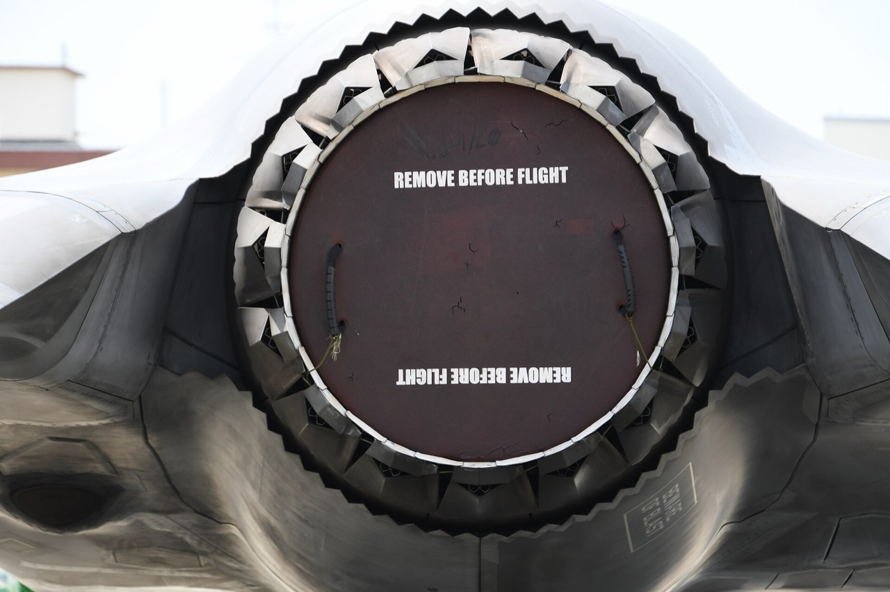

*Photo A.* F-35B 169164, VMFA-121, MCAS Iwakuni, 5 May 2018, from behind.
Photo: Hunini, CC BY-SA 4.0, resized. The fuselage ends in a serrated edge that
runs all the way round the nozzle and sits close to it. The upper and side parts
are the fixed shroud. The lower part is the aft edges of the two ventral doors.
Between the serrations and the nozzle's outer flaps there is only a narrow dark
shadow. You cannot see into the fuselage.

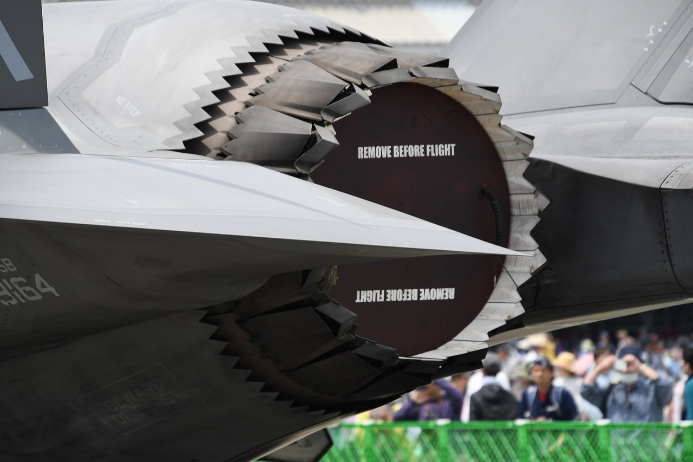

*Photo B.* Same aircraft and day, from the left rear. Photo: Hunini, CC BY-SA
4.0, resized. The serrations at the top and the bottom both wrap the nozzle. The
lower serrated panel, stencilled "BEWARE OF BLAST", is the left 3BSM door.

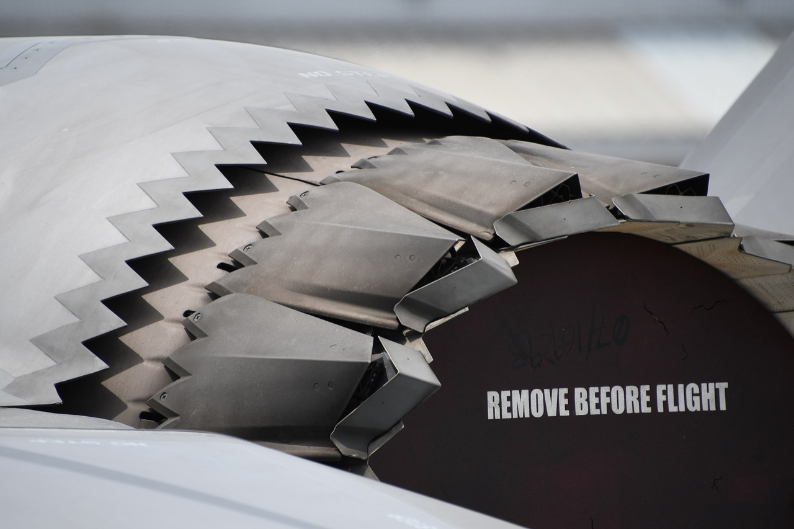

*Photo C.* Same aircraft and day, close-up from the left rear. Photo: Hunini,
CC BY-SA 4.0, resized. The skin's serrated edge overlaps the forward ends of the
nozzle's outer flaps, a few centimetres away. Inside each notch you see a flap
or its shadow, never the inside of the fuselage.

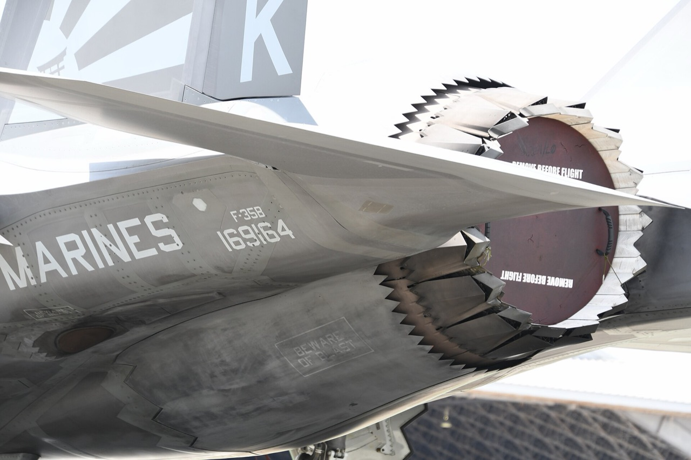

*Photo D.* Same aircraft and day, from the left rear and below. Photo: Hunini,
CC BY-SA 4.0, resized. The left door's serrated aft edge forms the lower part of
the ring under the nozzle.

### Hover (nozzle down, doors open)

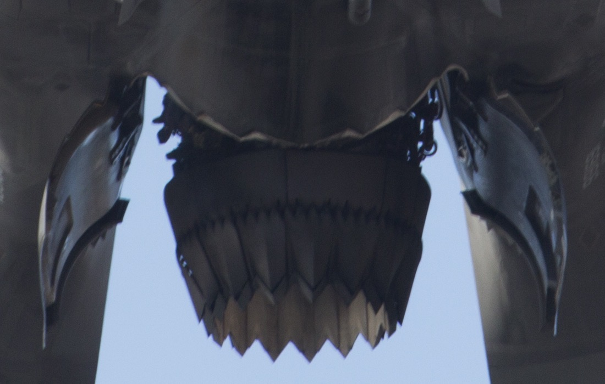

*Photo E.* VMFA-121 F-35B hovering at MCAS Iwakuni, 3 February 2017, from
directly below with the nose at the top, cropped. Photo: Lance Cpl. Joseph
Abrego, USMC, public domain. The two doors hang down on either side of the
nozzle, curved like clamshells. The fuselage underside is closed right up to the
duct, which comes out under a jagged skin edge. Dark lines and actuators show at
the corners of that edge. There is no sky and no view up into the engine bay.

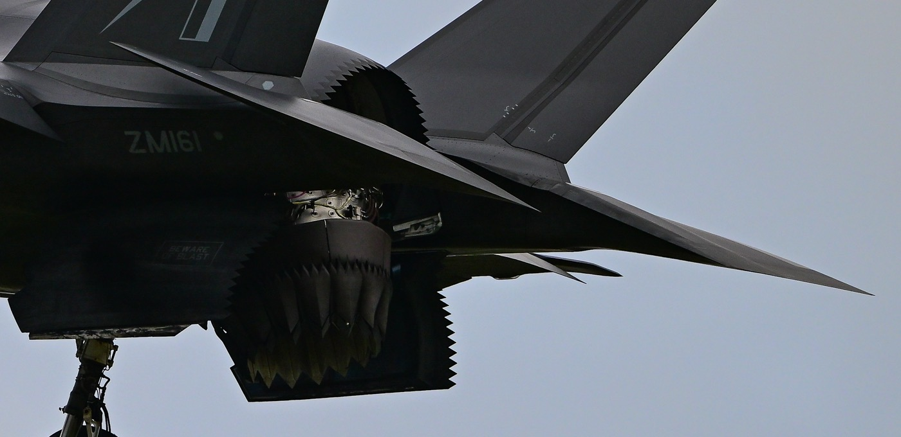

*Photo F.* RAF F-35B ZM161 hovering at RIAT 2023, from the left side and
slightly below, cropped. Photo: Bernardo Fernández Copado, CC BY 2.0. The
upper horseshoe of the serrated shroud stays in place, with a dark recess inside
it. Bare-metal actuators and lines are visible on top of the swivel duct, just
below the fuselage. Both doors are open: the near one is in front of the duct
and the far one behind it.

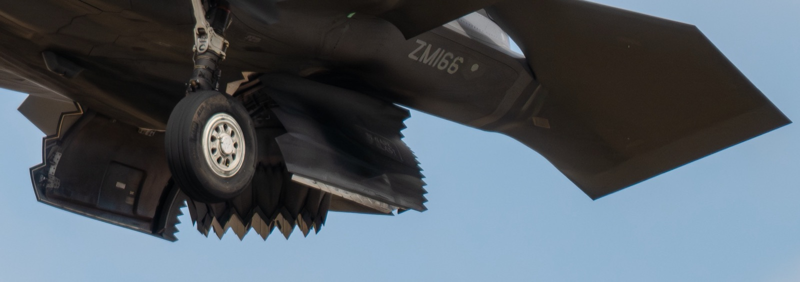

*Photo G.* RAF F-35B ZM166 hovering at RIAT 2025, from the left front and below,
cropped and resized. Photo: Julian Herzog, CC BY 4.0. The door hangs about
vertically beside the duct. Below the fuselage the duct shows smooth dark casing
down to the nozzle flaps.

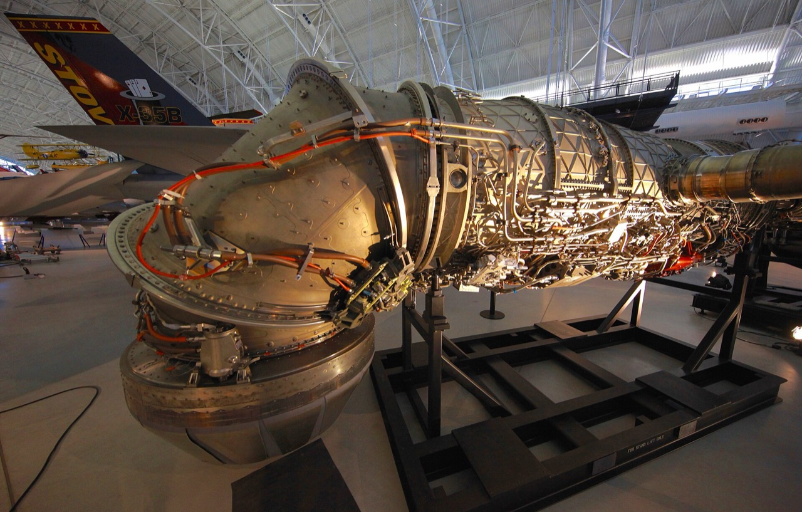

*Photo H.* An engine with its three-bearing swivel duct, displayed beside the
X-35B at the Steven F. Udvar-Hazy Center, 2016, resized. Photo: Steve
Jurvetson, CC BY 2.0. It is captioned as the F135 for the F-35B, but because it
is shown with the X-35B it is probably the X-35B's engine. This doc uses it only
for the general look of the bearings and the lines that run outside the duct.

### Features the model should reproduce

1. The serrated aft edge sits close round the nozzle in cruise, with a dark
   shadow behind it and no view into the fuselage (photos A–D).
2. The lower part of that ring is the two door edges. The upper part is fixed
   (photos A, B, D).
3. In hover the doors hang down on either side of the duct and stay open. The
   upper horseshoe remains, with a dark recess and no gap into the engine bay
   (photos E, F, G).
4. From below in hover the underside is closed right up to the duct. Hardware
   is visible on top of the duct and at the corners of the opening, and there
   is no fairing (photos E, F).
5. The engine's outer casing, not its inner liner, is what shows outside the
   swivel duct (photos G, H).

## The model from the same angles

Each sheet shows F-35B by AF267, the current 0SFS assembly and the proposed
closeout. They are flat-shaded, GPU-free renders in each mesh's base colour
(engine blue, AF267 grey). Green is background. Camera angles approximate the
photos and are orthographic.

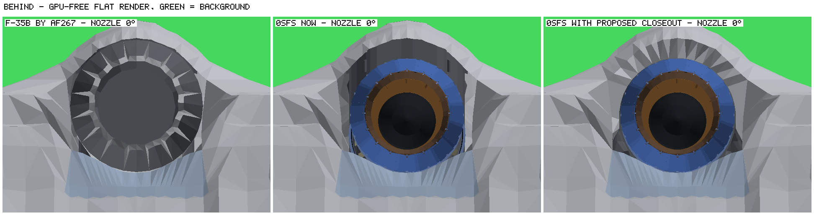

**Behind, cruise (photo A).** AF267's tube and nozzle close the opening. The
current model shows a lit grey cavity above and beside the engine. The proposal
fills that space with a skin-coloured flange from the serrated edge to just
outside the nozzle, plus a dark recess at the lower corners.

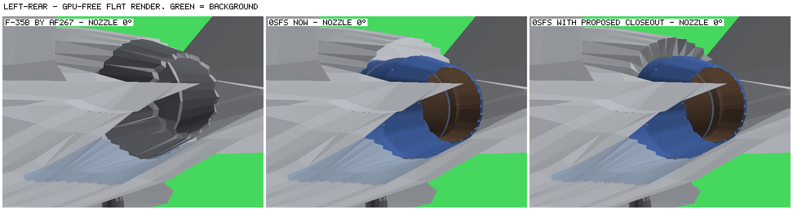

**Left rear, cruise (photo B).** The current model shows the inside of the upper
skin above the nozzle. The proposal's flange carries the serrations down to the
nozzle, as in photos B and C.

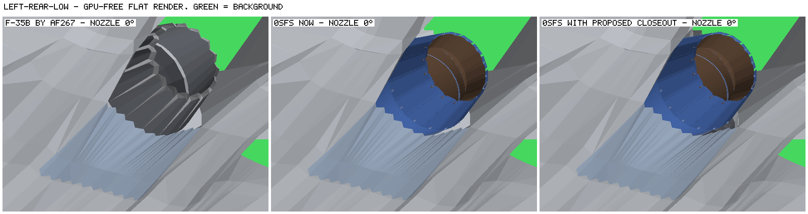

**Left rear and low, cruise (photo D).** Little changes from this angle: the
door already covers the lower side, and a small dark recess shows at the lower
corner.

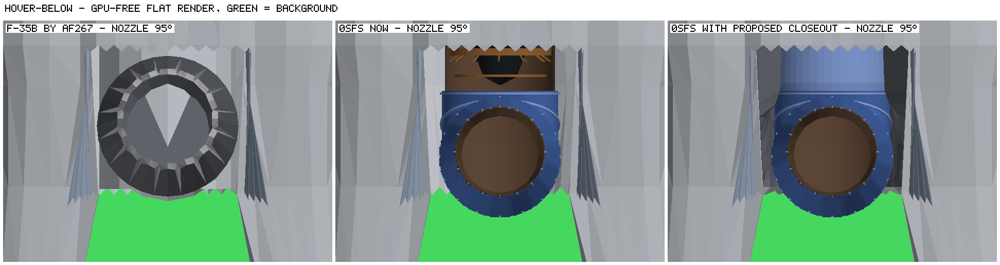

**Below, hover (photo E).** The current model shows the open augmentor liner
forward of the duct, because the installed engine has no outer casing there. The
proposal shows engine casing between dark recess walls. This is the largest
remaining difference from the photo: see [Remaining differences](#remaining-differences).

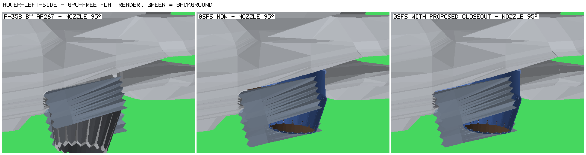

**Left side, hover (photo F).** The near door hides most of the closeout. The
only difference from this angle is a sliver of liner above the duct in the
current model. The upper horseshoe and its recess from photo F do not show at
this render's angle, so the behind and below views are what check them.

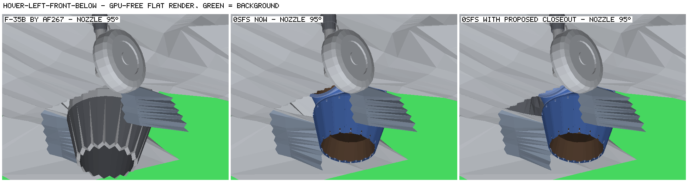

**Left front and below, hover (photo G).** In the current model you can see into
the bay beside the duct. With the proposal, that view ends at the dark recess
wall.

## What is missing, measured

AF267's removed parts were:

- the `vtol` node, 348 triangles of nozzle;
- 16 nozzle feathers of 20 triangles each;
- the `extras` tube, 124 livery triangles. This was a full 360° sleeve with an
  outer wall at radius 0.624 m and an inner wall at 0.572 m, running from
  z 2.175 to 3.736 m about AF267's old nozzle axis (y 2.282 m).

The nozzle had to go. The tube was structure. It cannot simply be kept, though:
it would collide with the lowered 0SFS engine, which sits 0.10 m lower, and with
the doors' swing, and it never closed the forward part of the opening.

Without the tube, the fuselage's aft opening (radius 0.64–0.77 m around the
engine axis) surrounds an engine of radius 0.53–0.55 m. The aft fuselage behind
the opening is a wide, flat cavity with no side walls round the engine. Probe
rays fired through the gap travel 5–9 m forward before they hit anything.

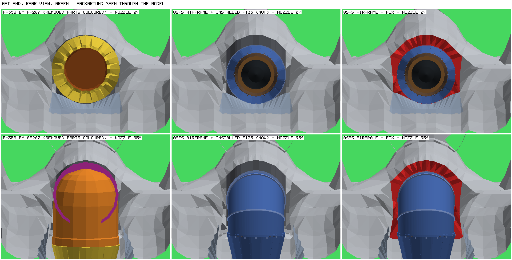

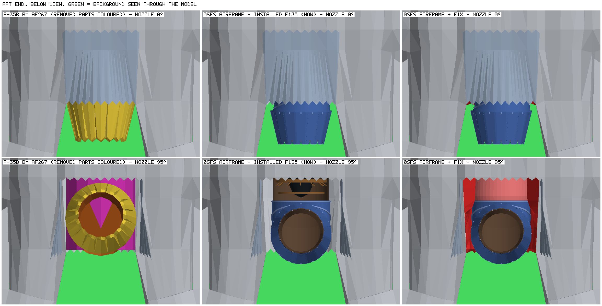

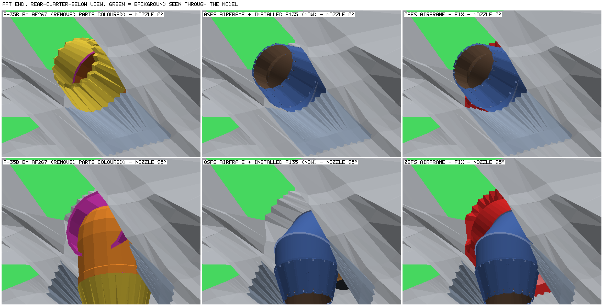

The three sheets above use highlight colours. AF267's removed nozzle is orange
and yellow, its tube is magenta, the proposed closeout is red and the proposed
casing band is pink.

The table gives the largest visible area of fuselage interior in each view. It
is the maximum over 60 poses: nozzle pitch 0, 5, 10, 15, 20, 25, 45, 65, 90 and
95°, yaw −10, 0 and +10°, aperture closed and open. The sky seen through the bay
is at most 0.011 m² in every model.

| View | AF267 | 0SFS now | Proposal |
| --- | ---: | ---: | ---: |
| Rear | 0.366 m² | 0.686 m² | 0.074 m² |
| Rear quarter, above | 0.071 m² | 0.357 m² | 0.010 m² |
| Rear, steep from above | 0.034 m² | 0.080 m² | 0.025 m² |
| Rear quarter, below | 0.319 m² | 0.512 m² | 0.012 m² |
| Rear, steep from below | 0.301 m² | 1.009 m² | 0.011 m² |
| Below | 0.117 m² | 0.442 m² | 0.015 m² |

The proposal's figures do not change with the nozzle pose. They are back faces
of the outer skin at the fuselage shoulders and edges, which show in every
model, not openings. AF267 has the same slivers. On top of them it has a band of
skin interior visible round its own nozzle, which widens as that nozzle
swivels. Its removed parts are counted separately and are not part of these
figures.

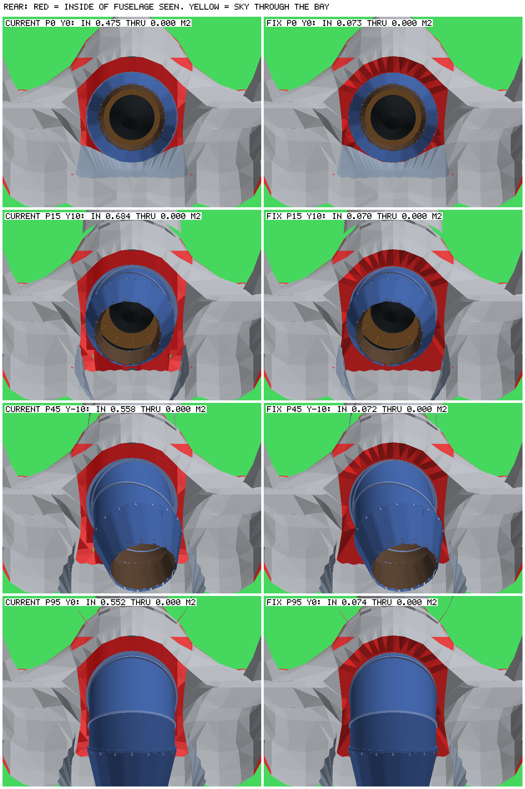

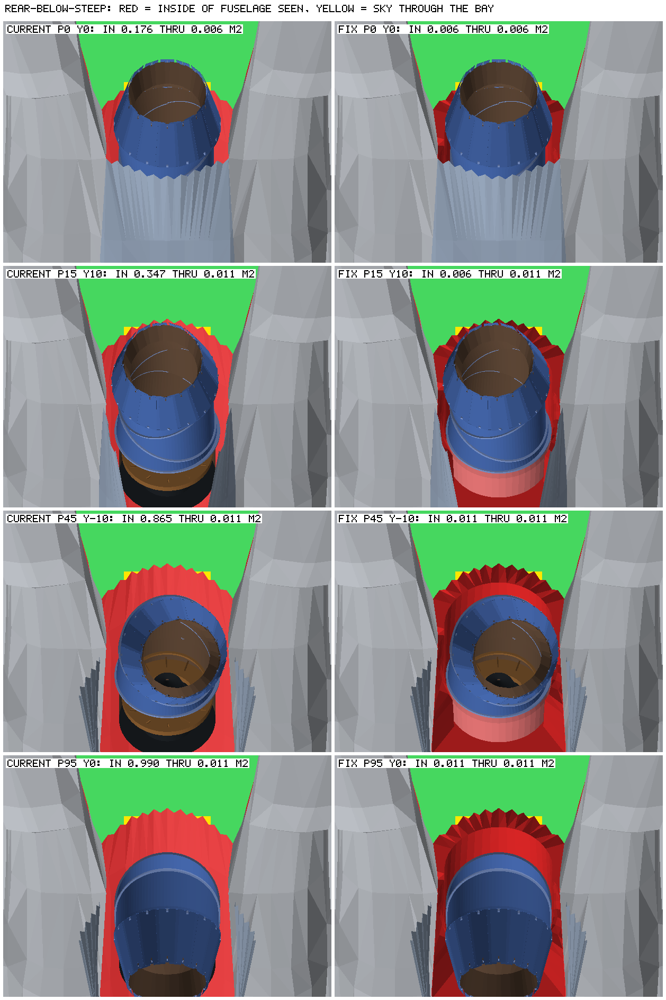

In these two sheets, red is fuselage interior seen from outside and yellow is
sky through the bay. In the proposal column, darker red is the closeout itself.

## Proposed closeout

1. **A new fixed closeout, generated into the airframe GLB by the build**, next
   to `removeOriginalNozzle` in `F135/scripts/f135Engine/glb.mjs`. It has three
   parts:
   - a livery-coloured flange from the serrated aft edge to a rim 1.5 cm outside
     the swept nozzle;
   - a dark recess tunnel (AF267's `darkmet2`) from that rim forward to z 2.418,
     sealed along the edges of the door cut;
   - a dark bulkhead at the front of the door cut, running round the engine
     casing.

   It reuses AF267's livery and `darkmet2` materials and adds about 764
   triangles to the existing `extras` primitives.
2. **The augmentor's outer casing, made visible in the installed engine.** In
   the F135 source, the casing from z_eng −0.47 to −0.025 becomes a shared
   piece rather than a stand-only one. That is 384 triangles at the casing's 96
   segments, so the seam shares the stand-only casing's vertices. It also closes a 5 cm slot in the test-stand model at z_eng
   −0.0775 to −0.025, where the inner liner shows.
3. **An extended clearance check.** `check-f135-clearance.mjs` would also test
   the doors against the closeout.

The swept shape of the nozzle sets the closeout's shape. It covers pitch 0–95°,
yaw ±10° and aperture 0–1, sampled at 1.2 cm or finer. A scratch prototype of
1 and 2 had **no intersections** in any of these checks:

- against the installed engine in 585 poses: pitch 0–95° in 2.5° steps, five
  yaw values and three apertures;
- against the doors as the rig poses them for pitch 0–95°;
- against the static airframe;
- the casing band against the airframe, doors and closeout.

Published figures put 3BSM yaw at ±12.25° (Lockheed Martin) or ±11°
(Rolls-Royce). The sweep follows the 0SFS rig, which uses ±10°.

## Implementation

The build now does all three, in the F135 repository:

- `scripts/f135Engine/closeout.mjs` generates the closeout from AF267's
  fuselage, the engine-door cut and the installed engine swept through every
  pose. If the nozzle changes, the closeout follows it at the next build.
- `removeOriginalNozzle` in `scripts/f135Engine/glb.mjs` appends it to the
  `extras` livery and `darkmet2` primitives. That adds no draw call, and it
  leaves the `fuselage` and the weapon-bay doors byte for byte as they were.
- `scripts/f135Engine/source.mjs` splits `F135_AftCasing` from the external
  casing.
- `scripts/validation/f35b/check-f135-clearance.mjs` checks the engine doors
  against `extras` as well as the fuselage.

`npm run build:engine-assets` regenerated the assets:

| Asset | Triangles before | Triangles after | Bytes before | Bytes after |
| --- | ---: | ---: | ---: | ---: |
| `F-35B_AF267-airframe.glb` | 11,467 | 12,231 | 1,444,788 | 1,466,196 |
| Installed engine | 12,592 | 12,976 | 1,037,840 | 1,066,152 |
| Test-stand engine | 24,024 | 24,408 | 1,864,272 | 1,892,588 |

The airframe's added triangles split into 60 for the flange, 560 for the
recess and 144 for the bulkhead.

Checks:

- `npm run verify:engine-assets` passes.
- The clearance check ran 150 cases with no failures. The engine touched
  neither the airframe nor the closeout, and nothing intersected itself. The
  doors touched only the fuselage, at pitch 0, on the closed seam the check
  already allows (5.7 mm). Nothing touched the closeout.
- The F135 build tests pass, including the rig test.
- In fly, the bay-door, stores and stores integration tests pass. So do the
  aircraft-model and flight-app tests. The fuselage and doors did not change,
  so no store or door fit moved.

To compare in the app, run `cd ~/gh/0sfs/fly && npm run dev` and choose the
F-35B. `/fly/` shows the new closeout in the flight view, and
`/fly/?engineTest=1` puts the full engine, with its aft casing band, on the
engine test stand. Adding `modelOverride=before-closeout` to either address
(`/fly/?modelOverride=before-closeout`, or
`/fly/?engineTest=1&modelOverride=before-closeout`) loads the airframe and both
engines as they were before this change. The set is kept in fly's ignored
`build/model-overrides/`, and fly's README describes it.

## Remaining differences

- **Below, in hover.** From directly below, the proposal shows about 0.4 m of
  engine casing between dark walls, forward of the swivelled duct (z 2.45–2.84).
  Photo E shows the skin edge right at the duct, so the door cut inherited
  from AF267 is probably longer than the real opening. Closing that strip means
  reshaping AF267's door cut and doors, which is outside this fix.
- **Lower corners, in cruise.** From behind, a dark recess about 10 cm wide
  remains at the four and eight o'clock positions. The closeout is fixed
  structure, so it has to clear the nozzle as it yaws at intermediate pitch. On
  the real aircraft that region is closed by the doors' serrated edges (photo
  A), and the doors open before the nozzle moves.
- **Detail on top of the duct.** Photos F and H show actuators and lines outside
  the duct. The installed engine deliberately leaves out the stand-only
  accessories, so none of this hardware appears in flight.
- **Flange shape.** The real serrations overlap the nozzle's outer flaps by a
  few centimetres (photo C). The proposed flange keeps AF267's serrated edge
  and stops 1.5 cm outside the swept nozzle, so it never overlaps.

## Sources

1. K. Renshaw, "F-35B Lightning II Three-Bearing Swivel Nozzle", Code One,
   12 August 2014: <https://www.codeonemagazine.com/article.html?item_id=137>.
   Describes three angled duct segments on airtight bearings, with the centre
   segment turning 180° relative to the others, and 95° of pitch travel.
2. Wiegand et al., "F-35 Air Vehicle Technology Overview", AIAA 2018-3368,
   Lockheed Martin, June 2018:
   <https://www.lockheedmartin.com/content/dam/lockheed-martin/eo/documents/webt/F-35_Air_Vehicle_Technology_Overview.pdf>.
   Gives 95° pitch and ±12.25° yaw, and a shorter low-observable axisymmetric
   nozzle on the B.
3. Lockheed Martin, 29 May 2008, "F-35B Succeeds in STOVL Propulsion Ground
   Test":
   <https://news.lockheedmartin.com/2008-05-29-Lockheed-Martin-F-35B-Succeeds-in-STOVL-Propulsion-Ground-Test>.
   The "aft fuselage 3-bearing swivel duct doors" open at conversion.
4. Lockheed Martin, 18 December 2007, F-35B rollout:
   <https://news.lockheedmartin.com/2007-12-18-First-Short-Takeoff-Vertical-Landing-Stealth-Fighter-Unveiled-at-Lockheed-Martin>.
   "Doors beneath the 3-bearing swivel nozzle open."
5. G. Warwick, "STOVL F-35B opens doors in flight", Aviation Week, 2 September
   2008: <https://aviationweek.com/stovl-f-35b-opens-doors-flight>.
   Paywalled; only the summary was read.
6. US 2012/0275905 A1, Lockheed Martin: <https://patents.google.com/patent/US20120275905>.
   Calls them "an aft set of clamshell doors".
7. G. Pyers, "Lift System Overview", Rolls-Royce, ICAS 2016:
   <https://www.icas.org/media/pdf/ICAS%20Congress%20General%20Lectures/2016/2016%20Innovation%20award%20LiftSystemTalk.pdf>.
   Gives ±11° yaw.

## Image credits

The photographs are copied from Wikimedia Commons under the licences below.
They were resized and, where noted, cropped. Each adapted photo keeps its
original licence: the CC BY-SA 4.0 adaptations are shared under CC BY-SA 4.0.
The renders contain geometry from **Lockheed Martin F-35B Lightning II** by
[AF267](https://sketchfab.com/jsong.js.us), provided by
[Sketchfab](https://sketchfab.com/3d-models/lockheed-martin-f-35b-lightning-ii-5d54a6af45974ad386ae74d42b33374a)
under [CC BY 4.0](https://creativecommons.org/licenses/by/4.0/), together with
0SFS's F135 and closeout geometry. No endorsement by any photographer, AF267 or
Lockheed Martin is implied.

| Image | Source | Author | Licence | Changes |
| --- | --- | --- | --- | --- |
| A | [169164 exhaust nozzle, behind view](https://commons.wikimedia.org/wiki/File:U.S._Marine_Corps_F-35B_Lightning_II(169164)_of_VMFA-121_exhaust_nozzle_behind_view_at_MCAS_Iwakuni_May_5,_2018.jpg) | Hunini | [CC BY-SA 4.0](https://creativecommons.org/licenses/by-sa/4.0/) | resized |
| B | [169164 exhaust nozzle, left rear view 01](https://commons.wikimedia.org/wiki/File:U.S._Marine_Corps_F-35B_Lightning_II(169164)_of_VMFA-121_exhaust_nozzle_left_rear_view_at_MCAS_Iwakuni_May_5,_2018_01.jpg) | Hunini | [CC BY-SA 4.0](https://creativecommons.org/licenses/by-sa/4.0/) | resized |
| C | [169164 exhaust nozzle, left rear view 03](https://commons.wikimedia.org/wiki/File:U.S._Marine_Corps_F-35B_Lightning_II(169164)_of_VMFA-121_exhaust_nozzle_left_rear_view_at_MCAS_Iwakuni_May_5,_2018_03.jpg) | Hunini | [CC BY-SA 4.0](https://creativecommons.org/licenses/by-sa/4.0/) | resized |
| D | [169164 exhaust nozzle, left rear low-angle view](https://commons.wikimedia.org/wiki/File:U.S._Marine_Corps_F-35B_Lightning_II(169164)_of_VMFA-121_exhaust_nozzle_left_rear_low-angle_view_at_MCAS_Iwakuni_May_5,_2018.jpg) | Hunini | [CC BY-SA 4.0](https://creativecommons.org/licenses/by-sa/4.0/) | resized |
| E | [F-35B training flights 170203-M-ON157-0436](https://commons.wikimedia.org/wiki/File:F-35B_Lighting_II_training_flights_170203-M-ON157-0436.jpg) | Lance Cpl. Joseph Abrego, USMC | Public domain | cropped |
| F | [RIAT 2023 F-35B NZ9 7916](https://commons.wikimedia.org/wiki/File:Riat_2023_-_Royal_Air_Force_-_Lockheed_Martin_F-35B_Lightning_NZ9_7916_(53070442940).jpg) | Bernardo Fernández Copado | [CC BY 2.0](https://creativecommons.org/licenses/by/2.0/) | cropped |
| G | [ZM166 RIAT 2025 01](https://commons.wikimedia.org/wiki/File:Royal_Air_Force_Lockheed_Martin_F-35B_Lightning_II_ZM166_032_Royal_International_Air_Tattoo_2025_01.jpg) | Julian Herzog | [CC BY 4.0](https://creativecommons.org/licenses/by/4.0/) | cropped, resized |
| H | [Hover fan of the Lockheed F35B](https://commons.wikimedia.org/wiki/File:Hover_fan_of_the_Lockheed_F35B.jpg) | Steve Jurvetson | [CC BY 2.0](https://creativecommons.org/licenses/by/2.0/) | resized |
