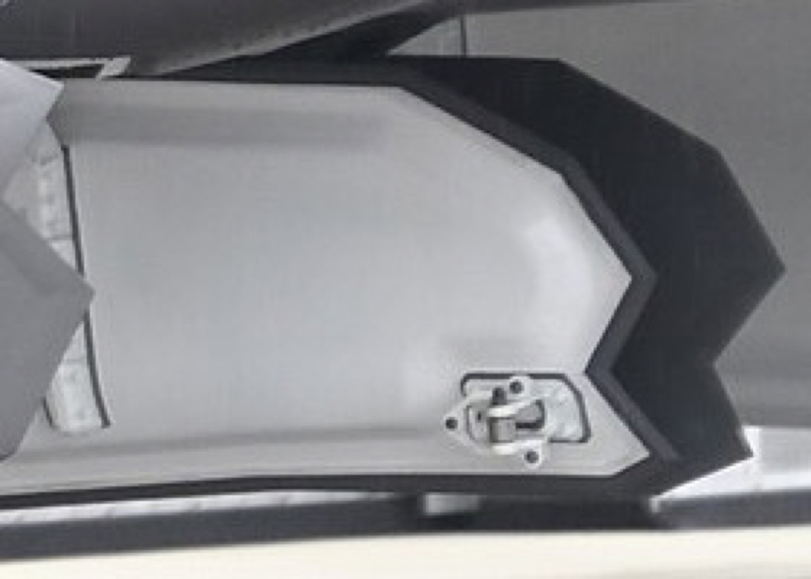
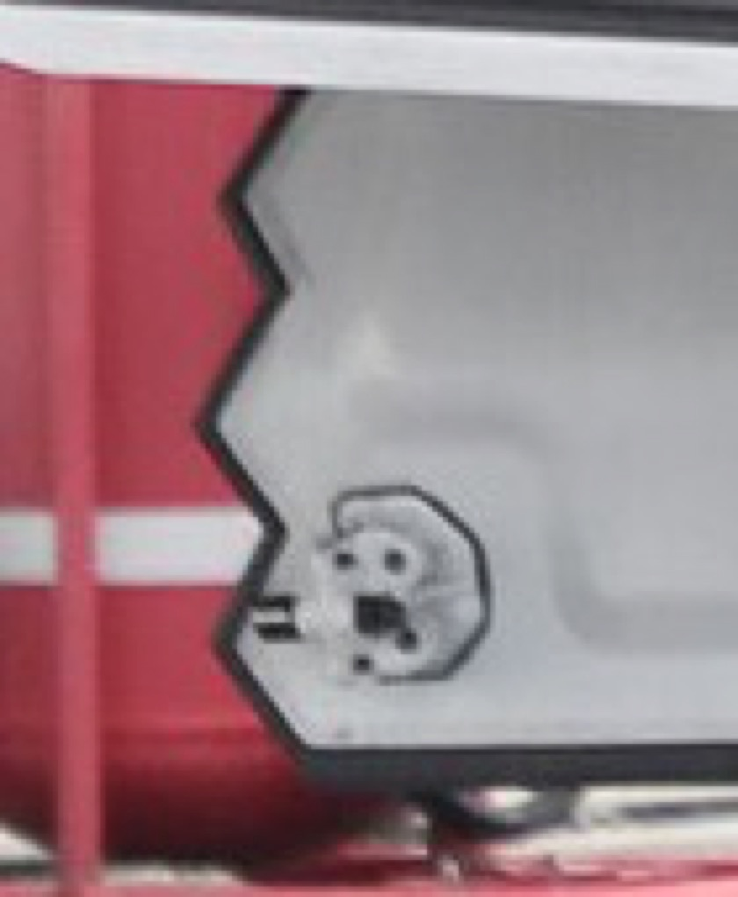
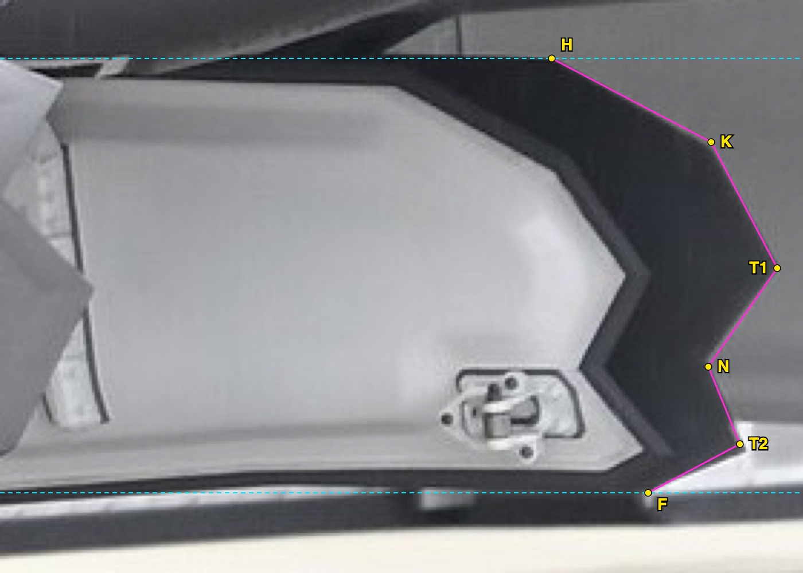
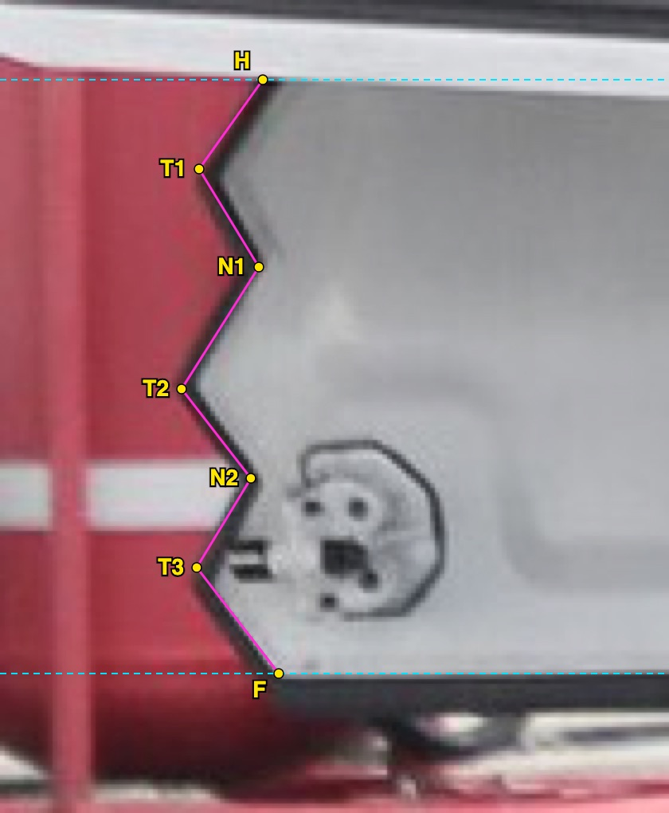
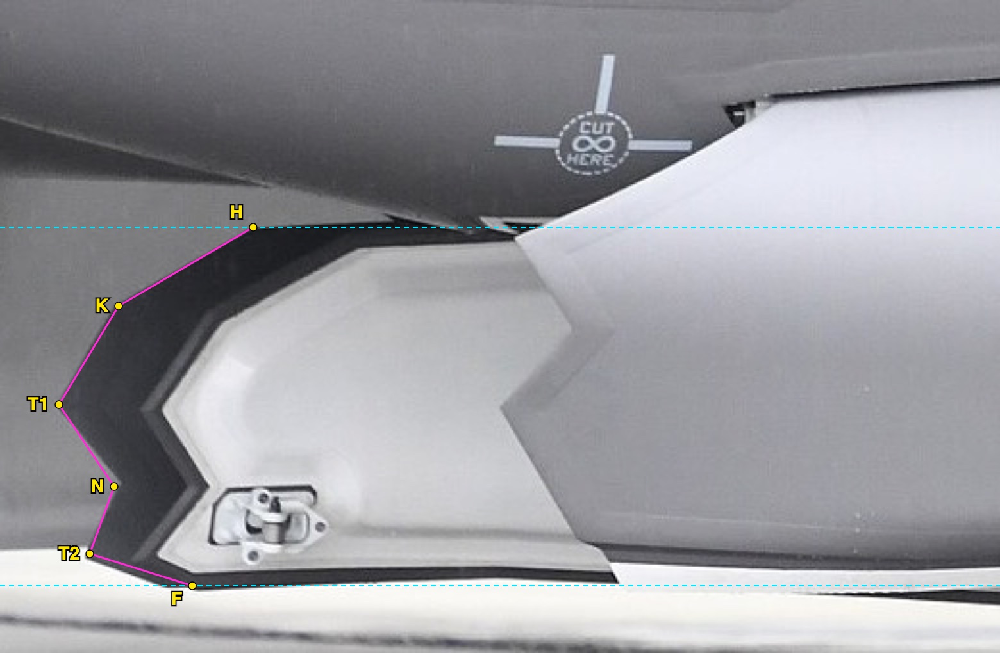
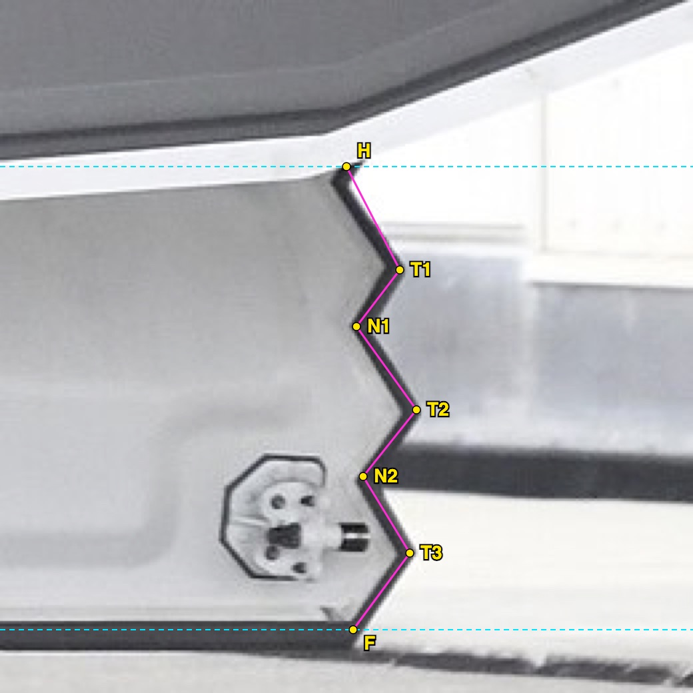
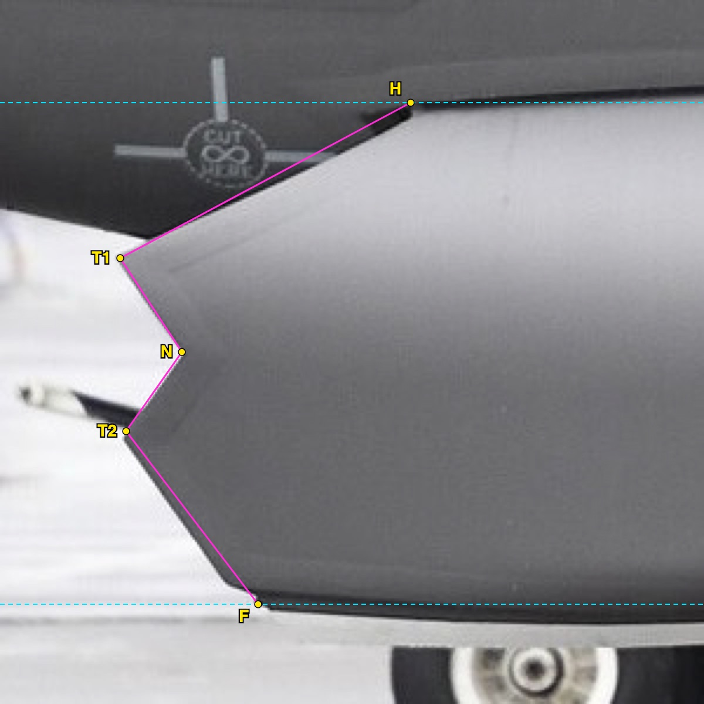
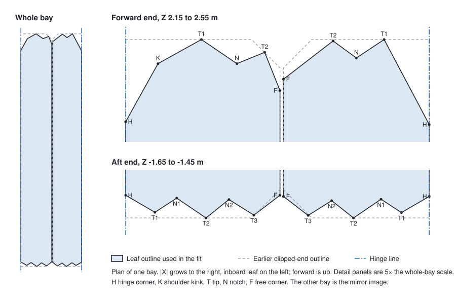

# F-35B weapon-bay door serrations: how the shape was traced

Date: 2026-10-24. Status: method record for the serrated door ends in the
[AF267 weapon-bay door fit](f35b-weapon-bay-door-geometry.md).

On the real jet, the forward and aft ends of the weapon-bay doors are serrated
instead of straight. No published drawing gives the tooth count, depth or
angles. This document records how the shape was read from photographs, so that
anyone can check the reading, repeat it, or replace it with better evidence.

The result is a **visual fit**, like the rest of the door fit. Every number
below comes from photographs, read by eye and then rounded. None is a
manufacturer dimension.

## The shape

The two clearest views of the serrations are forward and aft crops of one
photograph. Both show the same leaf: the inboard leaf of the right-hand bay,
hanging open. The camera looks at its light-grey inner face from the right
side of the aircraft.



*Forward end, nose to the right. The hinge is at the top and the free edge at
the bottom. The dark band is the door's edge. Its outer boundary is the edge
of the outer skin, and that boundary is what was traced. From the hinge down
the boundary has a steep shoulder with a kink, a forward tip, a notch, a
second tip that stands slightly further back, and a short steep run to the
free corner.*



*Aft end of the same leaf, nose to the right, so aft is to the left. Three
tips point aft. A notch lies between each pair of tips, and both corners are
set back like notches. The middle tip is the most aft.*

Both crops are from photo A in the table below, by Hunini, CC BY-SA 4.0. They
are cropped, enlarged and, further down, traced. [Image credits](#image-credits)
gives the full credit.

## Sources

All four photographs are on Wikimedia Commons. They were found with
full-text searches of Commons files and categories, for example
"F-35 weapons bay doors". A photograph was kept when it met three conditions:

- It is free to reuse.
- The doors hang open.
- The door ends are seen roughly side-on, with the dark edge against a
  plain background.

| Photo | Commons file | Author and licence | What it shows | Used for |
| --- | --- | --- | --- | --- |
| A | [JASDF F-35B (69-8205) weapon bay right front view at MCAS Iwakuni May 3, 2026 01](https://commons.wikimedia.org/wiki/File:JASDF_F-35B_(69-8205)_weapon_bay_right_front_view_at_MCAS_Iwakuni_May_3,_2026_01.jpg) | Hunini, own work, CC BY-SA 4.0 | Right side, from slightly forward. The outboard leaf's exterior is in front, and the inboard leaf's inner face is behind it. | Inboard leaf, both ends |
| B | [JASDF F-35B (69-8205) weapon bay left front view at MCAS Iwakuni May 3, 2026 03](https://commons.wikimedia.org/wiki/File:JASDF_F-35B_(69-8205)_weapon_bay_left_front_view_at_MCAS_Iwakuni_May_3,_2026_03.jpg) | Hunini, own work, CC BY-SA 4.0 | Left side, from slightly forward. The same pair of leaves, on the other bay. | Inboard leaf, both ends: a second reading |
| C | [JASDF F-35B (69-8205) weapon bay right side view at MCAS Iwakuni May 3, 2026](https://commons.wikimedia.org/wiki/File:JASDF_F-35B_(69-8205)_weapon_bay_right_side_view_at_MCAS_Iwakuni_May_3,_2026.jpg) | Hunini, own work, CC BY-SA 4.0 | Close to square-on to the outboard leaf's exterior. The file title says right side, but the photograph and its Japanese description (左側面) show the left side. | Outboard leaf, forward end |
| D | [190116-F-BQ566-003](https://commons.wikimedia.org/wiki/File:190116-F-BQ566-003.jpg) | U.S. Air Force photo by Senior Airman Alexander Cook, public domain | An F-35A of the F-35 Demonstration Team, Luke AFB, 16 January 2019, from below with the bays open. | Pattern across a whole bay end, by eye only |

Photos A, B and C are the same aircraft, JASDF F-35B 69-8205, at MCAS
Iwakuni on 3 May 2026. Photo D is an F-35A. It was used only to confirm the
pattern across a whole bay end, not for any number.

Five more Commons photographs were reviewed: an F-35B bomb drop, the first
F-35B aerial weapons release, a 2007 weapons-bay photograph, a fourth Iwakuni
view (left front 01) and a 2019 Aviation Nation display. No reading was taken
from them. Their door ends were too small, edge-on, or not clear enough to
trace.

The files used are the 1920-pixel-wide renditions that Commons serves. The
originals of A, B and C are 5408 × 3600. SHA-256 of the files read:

| Photo | SHA-256 |
| --- | --- |
| A | `b482c7eb264d21d25d887ec49024dd962ac429523c9dc22e4ef5f87c8f6e1028` |
| B | `1e0d4e46186d0c72db5d1d9fe0a1e49d5112d86fb232c222f20180a15759b48c` |
| C | `8807f3fb3872ac799d6c2641d7670b8510dfdb5790829bf3e56e4c39125a1c69` |
| D | `236ff4613ae1624e8528c729f6e5eee6b28401775961309df1027424d06b26c3` |

## Method

### 1. Tell the leaves apart

An open leaf hangs from its hinge, so its hinge is at the top of the picture
and its free edge at the bottom. From outside the aircraft, the outboard leaf
shows its dark exterior. The inboard leaf hangs further in, and shows its
light inner face through the open bay. The nose direction gives forward.

In photo A the front, dark leaf is the right bay's outboard leaf. The light
leaf behind it is the right bay's inboard leaf. The camera is ahead of the
bay, so the farther leaf appears shifted toward the nose. Its forward end
stands clear of the near leaf, and its aft end shows below the near leaf.

### 2. Crop and enlarge

Each door end was cut out of the 1920-pixel image with macOS `sips` and
enlarged by a whole number, so that the edge could be read to a pixel or two:

```sh
sips -c <height> <width> --cropOffset <top> <left> image.jpg --out crop.jpg
sips -z <height × n> <width × n> crop.jpg --out crop-xn.jpg
```

| Crop | Photo | Size | Top, left | Enlarged |
| --- | --- | --- | --- | --- |
| Inboard forward | A | 200 × 280 | 620, 1320 | × 5 |
| Inboard aft | A | 170 × 140 | 750, 380 | × 6 |
| Inboard forward | B | 340 × 520 | 520, 60 | × 3 |
| Inboard aft | B | 260 × 260 | 690, 1480 | × 4 |
| Outboard forward | C | 300 × 300 | 540, 120 | × 4 |

The outboard leaf's aft end is hidden by the main landing gear in every
photograph found. There is no crop of it.

### 3. Trace the edge

The vertices were placed by hand on the outer boundary of the dark edge band:

- H, the hinge corner
- K, a kink in the shoulder
- T, each tip
- N, each notch
- F, the free corner

Numbers count from the hinge. The trace was drawn over the enlarged crop as an
SVG polyline and rendered with headless Chrome. Each point was then moved until
the line sat on the edge. The dashed lines mark the hinge row and the
free-edge row.





The same ends on the other bay, from photo B:





The outboard leaf's forward end, from photo C:



Traced points, in pixels of each enlarged crop (x right, y down):

| Crop | Points, hinge to free edge |
| --- | --- |
| A inboard forward | H 962,102 · K 1240,248 · T1 1355,468 · N 1235,640 · T2 1290,775 · F 1130,860 |
| A inboard aft | H 330,100 · T1 250,212 · N1 325,335 · T2 228,488 · N2 315,600 · T3 247,712 · F 350,845 |
| B inboard forward | H 395,355 · K 185,478 · T1 92,632 · N 178,760 · T2 140,865 · F 300,915 |
| B inboard aft | H 520,250 · T1 600,405 · N1 535,490 · T2 625,615 · N2 545,715 · T3 615,830 · F 530,945 |
| C outboard forward | H 700,175 · T1 205,440 · N 310,600 · T2 215,735 · F 440,1030 |

### 4. Turn pixels into leaf fractions

The hanging leaf's height in the picture is its plan width. That gives a scale
that does not depend on the camera's distance. For each point:

- **u**, the position across the leaf, is
  (y − y<sub>hinge</sub>) / (y<sub>free</sub> − y<sub>hinge</sub>). It runs
  from 0 at the hinge to 1 at the free edge.
- **s / W**, the set-back, is the point's distance behind the end-most tip,
  divided by the same pixel height. A forward point's set-back is measured
  aft of the foremost tip, and an aft point's forward of the aftmost tip.
- The set-back in metres is s / W times the AF267 fit's leaf width: 0.544 m
  inboard and 0.514 m outboard.
- The edge angle is atan(Δs / Δu), measured from the spanwise direction.

| End | Point | A: u, s (m) | B: u, s (m) | Adopted u, s (m) |
| --- | --- | --- | --- | --- |
| Inboard forward | H | 0, 0.282 | 0, 0.294 | 0, 0.290 |
| | K | 0.193, 0.083 | 0.220, 0.090 | 0.21, 0.085 |
| | T1 | 0.483, 0 | 0.495, 0 | 0.49, 0 |
| | N | 0.710, 0.086 | 0.723, 0.084 | 0.72, 0.085 |
| | T2 | 0.888, 0.047 | 0.911, 0.047 | 0.90, 0.045 |
| | F | 1, 0.161 | 1, 0.202 | 1, 0.180 |
| Inboard aft | H | 0, 0.074 | 0, 0.082 | 0, 0.080 |
| | T1 | 0.150, 0.016 | 0.223, 0.020 | 0.19, 0.020 |
| | N1 | 0.315, 0.071 | 0.345, 0.070 | 0.33, 0.070 |
| | T2 | 0.521, 0 | 0.525, 0 | 0.52, 0 |
| | N2 | 0.671, 0.064 | 0.669, 0.063 | 0.67, 0.065 |
| | T3 | 0.821, 0.014 | 0.835, 0.008 | 0.83, 0.010 |
| | F | 1, 0.089 | 1, 0.074 | 1, 0.080 |

| End | Point | C: u, s (m) | Adopted u, s (m) |
| --- | --- | --- | --- |
| Outboard forward | H | 0, 0.298 | 0, 0.300 |
| | T1 | 0.310, 0 | 0.31, 0 |
| | N | 0.497, 0.063 | 0.50, 0.065 |
| | T2 | 0.655, 0.006 | 0.66, 0.005 |
| | F | 1, 0.141 | 1, 0.140 |

The adopted values are the mean of the two readings where there are two. They
are rounded to 0.01 in u and to 5 mm in s.

### 5. Check the two readings against each other

A and B show different bays from opposite sides of the aircraft. They agree
on every u to within 0.03, except the aft T1, which differs by 0.07. They
agree on every set-back to within 15 mm, except the forward free corner, which
differs by 41 mm. Both show the inboard forward T2 standing 47 mm behind T1,
so the fit keeps that step.

The tooth edges come out between 20° and 39° from spanwise, and most are
between 31° and 38°. The shoulders are steeper: about 60° at the inboard
hinge, 62° at the outboard hinge, and 62° to 73° at the inboard free corner.
Photo C, the most square-on view, gives 33° to 37° for the outboard teeth.
That is the same range as A and B.

Photo D shows each whole bay end from below, at low resolution. From one hinge
to the other it reads: a set-back corner, a tip, a notch at the split between
the leaves, a tip, and a set-back corner. At that resolution, each leaf's pair
of tips looks like one. The fit agrees: both leaves' free corners are set back,
so the fixed skin forms a V notch at the split.

### 6. Fill the gap: the outboard aft end

No photograph shows the outboard leaf's aft end. The fit gives it the inboard
aft end's pattern, counted from its own hinge. It uses the same u values, with
set-backs scaled by the width ratio 0.514 / 0.544, so the edge angles stay the
same. **This end is an assumption, not a reading.**

### 7. Place it on AF267

The serrations replace the earlier clipped ends. Nothing else in the fit
moves:

- The foremost tips stay on the earlier forward end line, Z 2.500 m.
- The aftmost tips stay on the aft end line, Z −1.600 m.
- The hinge lines, A and B, are unchanged. So are the leaf widths and the
  free-edge lines at |X| 0.894 and 0.906 m.

A point (u, s) becomes plan coordinates as follows:

- |X| = hinge |X| + u · W on the inboard leaf, or hinge |X| − u · W on the
  outboard leaf.
- Z = 2.500 − s at the forward end, or −1.600 + s at the aft end.

The result is rounded to the millimetre:

| Leaf | Outline, \|X\| and Z in metres |
| --- | --- |
| Inboard | (0.350, −1.520) (0.453, −1.580) (0.530, −1.530) (0.633, −1.600) (0.714, −1.535) (0.802, −1.590) (0.894, −1.520) (0.894, 2.320) (0.840, 2.455) (0.742, 2.415) (0.617, 2.500) (0.464, 2.415) (0.350, 2.210) |
| Outboard | (0.906, −1.524) (0.993, −1.591) (1.076, −1.539) (1.153, −1.600) (1.250, −1.534) (1.322, −1.581) (1.420, −1.524) (1.420, 2.200) (1.261, 2.500) (1.163, 2.435) (1.081, 2.495) (0.906, 2.360) |



In plan, the tooth edges of the adopted outline run 22° to 39° from spanwise.
The shoulders run 61° and 62° at the hinges and 68° at the inboard free
corner.

The model bevels each leaf's shell at 45° along these ends. With square
ends, the outboard leaves would sweep through the fixed skin left between
the teeth as they open. The [door fit](f35b-weapon-bay-door-geometry.md)
gives the details.

## Limits

- **Perspective is not corrected.** u is read across the hanging leaf, where
  the camera's yaw does not shorten distances. Set-backs are read along the
  aircraft as if each view were square-on. A and B look in from ahead of the
  bay, so their set-backs may read short. C is close to square-on and gives
  the same edge angles, which suggests the error is small. It was not
  measured.
- **The leaves are curved.** The trace treats each crop as flat.
- **The scale is the model's.** Fractions of the hanging width carry over to
  AF267's leaf widths, not to the real aircraft's.
- **The outboard aft end is assumed** from the inboard aft end.
- **Resolution.** The readings come from 1920-pixel renditions. The
  full-resolution originals would allow a finer trace.
- **No radar claim.** 0SFS does not simulate radar. The serrations change
  the look only.

To improve the fit, trace the full-resolution originals, or find a square-on
photograph of the outboard aft end. Then update the outline table in the
[door fit](f35b-weapon-bay-door-geometry.md) and `stores/src/stationTable.ts`
together.

## Image credits

Every photograph in this document is an adaptation of photo A, B or C by
**Hunini**, from Wikimedia Commons, licensed
[CC BY-SA 4.0](https://creativecommons.org/licenses/by-sa/4.0/). The changes
are cropping, enlarging and, in the "traced" images, a drawn outline with
labels. These adapted images are licensed CC BY-SA 4.0 too. That licence
covers the images only, not the rest of this repository.

- `a-inboard-forward.jpg`, `a-inboard-aft.jpg`, `a-inboard-forward-traced.jpg`
  and `a-inboard-aft-traced.jpg`: from
  [photo A](https://commons.wikimedia.org/wiki/File:JASDF_F-35B_(69-8205)_weapon_bay_right_front_view_at_MCAS_Iwakuni_May_3,_2026_01.jpg).
- `b-inboard-forward-traced.jpg` and `b-inboard-aft-traced.jpg`: from
  [photo B](https://commons.wikimedia.org/wiki/File:JASDF_F-35B_(69-8205)_weapon_bay_left_front_view_at_MCAS_Iwakuni_May_3,_2026_03.jpg).
- `c-outboard-forward-traced.jpg`: from
  [photo C](https://commons.wikimedia.org/wiki/File:JASDF_F-35B_(69-8205)_weapon_bay_right_side_view_at_MCAS_Iwakuni_May_3,_2026.jpg).

`plan.svg` is original, drawn from the outline table, and is licensed like the
rest of this repository.

Photo D is a U.S. Air Force photograph by Senior Airman Alexander Cook, in the
public domain. No copy of it is kept in this repository.
